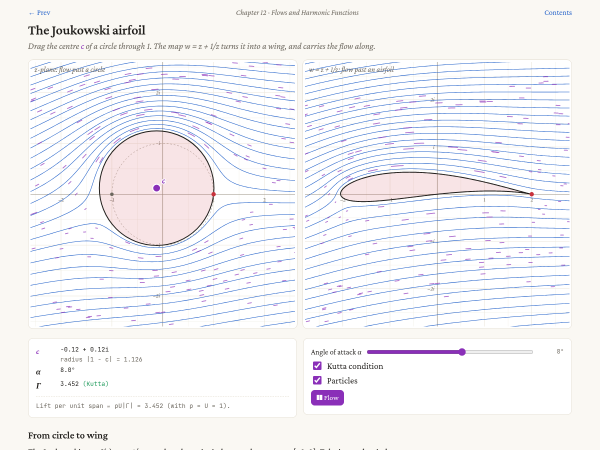

# Visual Complex Analysis — interactive illustrations

25 interactive pages that follow the 12 chapters of Tristan Needham's
*Visual Complex Analysis* (Oxford University Press). Drag the coloured dots,
move the sliders and watch the geometry behind complex analysis.

**▶ Live site: <https://luisrusso-inesc-id.github.io/VCA/>**

[](https://luisrusso-inesc-id.github.io/VCA/ch12-joukowski.html)

You can also open `index.html` in a browser straight from a clone. There is no
server, no build step and nothing to install to view the pages.

## Contents

| Ch. | Page | What it shows |
|----:|------|---------------|
| 1 | [Multiplication as rotation and scaling](ch01-multiplication.html) | Lengths multiply, angles add; the similar-triangle construction |
| 1 | [Squares on a quadrilateral](ch01-quadrilateral.html) | Centres of opposite squares give equal, perpendicular segments |
| 1 | [Euler's formula as a limit](ch01-euler.html) | (1 + iθ/n)ⁿ spirals onto the unit circle at e^{iθ} |
| 1 | [Powers, spirals and roots](ch01-powers-roots.html) | Equiangular spirals; n-th roots form a regular polygon |
| 2 | [Functions as transformations](ch02-mapper.html) | z², 1/z, e^z, sin z … warp a grid |
| 2 | [Multifunctions and branch points](ch02-multifunctions.html) | Loop around 0 and √z, ∛z or log z changes branch |
| 2 | [Power series as spirals of vectors](ch02-power-series.html) | Partial sums head to tail; the disc of convergence |
| 3 | [Inversion in a circle](ch03-inversion.html) | Circles and lines go to circles and lines |
| 3 | [The Riemann sphere](ch03-riemann-sphere.html) | Stereographic projection sends circles to circles |
| 3 | [Möbius transformations: the four types](ch03-mobius-flows.html) | Elliptic, hyperbolic, loxodromic flows and Steiner circles |
| 3 | [A Möbius map from three points](ch03-mobius-three-points.html) | Send 0, 1, ∞ anywhere; see the grid follow |
| 4 | [The amplitwist](ch04-amplitwist.html) | Locally, an analytic map is a rotation and a scaling |
| 4 | [Critical points](ch04-critical-points.html) | Where f′ = 0, angles are multiplied |
| 5 | [Hooke meets Kepler](ch05-kasner-arnold.html) | z² carries centred ellipses to ellipses with a focus at 0 |
| 5 | [Analytic continuation](ch05-analytic-continuation.html) | A chain of discs carries log around 0 and up by 2πi |
| 6 | [Hyperbolic triangles](ch06-hyperbolic-triangles.html) | Poincaré disc and half-plane; angle sum and area |
| 7 | [Winding numbers](ch07-winding-number.html) | Draw a loop; the plane is coloured by winding number |
| 7 | [The argument principle](ch07-argument-principle.html) | The image loop winds once per root inside |
| 8 | [Complex integration as Riemann sums](ch08-riemann-sums.html) | f(z)Δz arrows head to tail; path (in)dependence |
| 9 | [Cauchy's integral formula](ch09-cauchy-formula.html) | Values on a circle determine the inside |
| 9 | [Radius of convergence](ch09-taylor-radius.html) | Why 1/(1+x²) has radius 1: the hidden poles at ±i |
| 10 | [Index of a vector field](ch10-vector-field-index.html) | Zeros of a field and its winding along a loop |
| 11 | [The Pólya vector field](ch11-polya-field.html) | ∮ f dz = work + i·flux |
| 12 | [Ideal fluid flows](ch12-flows.html) | Complex potentials: sources, vortices, flow past a cylinder |
| 12 | [The Joukowski airfoil](ch12-joukowski.html) | z + 1/z maps a circle to a wing, with Kutta flow |

## How it is built

Every page is plain HTML, CSS and JavaScript. Pages use no framework and no
dependencies, apart from optional web fonts.

- `index.html`: the contents page
- `chNN-*.html`: one page per illustration (generated, see below)
- `lib/vca.js`: the shared library, which provides complex arithmetic
  (`VCA.C`), the `Plane` class (grid, drawing, draggable handles), controls
  (`UI`), animation, contour and winding-number helpers, the page scaffold
  and the site index (`VCA.PAGES`)
- `lib/vca.css`: shared styles, with light and dark modes
- `src/*.js`: the script of each page
- `build.py`: wraps each `src/<id>.js` into `<id>.html`, taking the title and
  description from `VCA.PAGES`

Web fonts load from Google Fonts when you are online. Offline, the pages fall
back to Georgia.

### Adding a page

1. Add an entry to `PAGES` in `lib/vca.js` (id, chapter, title, blurb).
2. Write `src/<id>.js`:
   ```js
   const { C } = VCA;
   const P = VCA.page({ id: "<id>", planes: [{ R: 2 }], explain: "<p>…</p>" });
   const [pl] = P.planes;
   pl.handle("z", { x: 1, y: 0.5 }, { color: "c1", label: "z" });
   VCA.run(() => { const z = pl.get("z"); pl.vec(C.mul(z, z), { color: "c3" }); });
   ```
3. Run `python3 build.py` (Python 3, standard library only) and commit both
   the source and the generated HTML.

## Credits

The illustrations are original code written to accompany Tristan Needham,
*Visual Complex Analysis* (Oxford University Press, 1997; 25th anniversary
edition 2023). Figure references are approximate. This project is not
affiliated with or endorsed by the author or the publisher, and it reproduces
no text or figures from the book. Get a copy of the book: these pages
are meant to be read alongside it.

Author: Luís M. S. Russo, ORCID [0000-0002-1966-1808](https://orcid.org/0000-0002-1966-1808).

The code was written with the help of [Claude Code](https://claude.com/claude-code).

## License

[MIT](LICENSE) © 2026 Luís M. S. Russo
